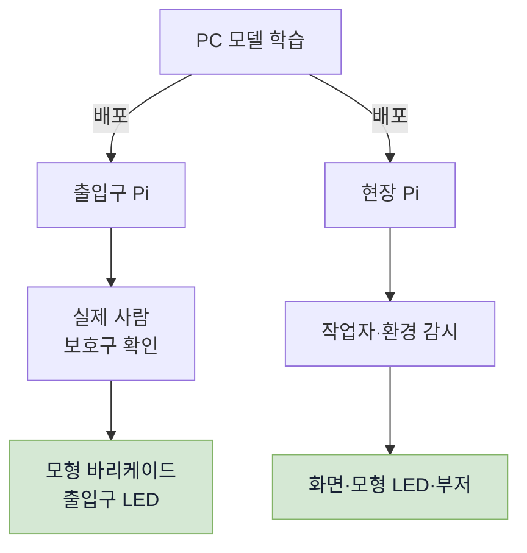
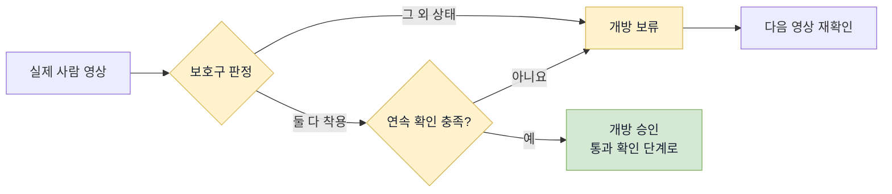
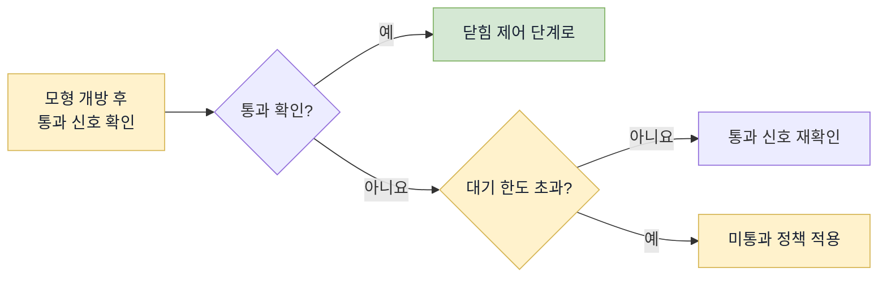
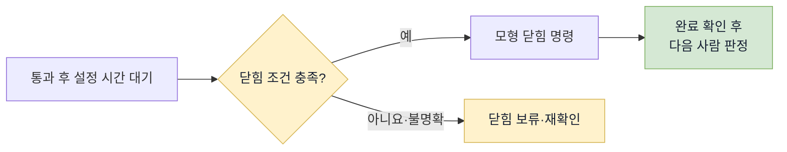
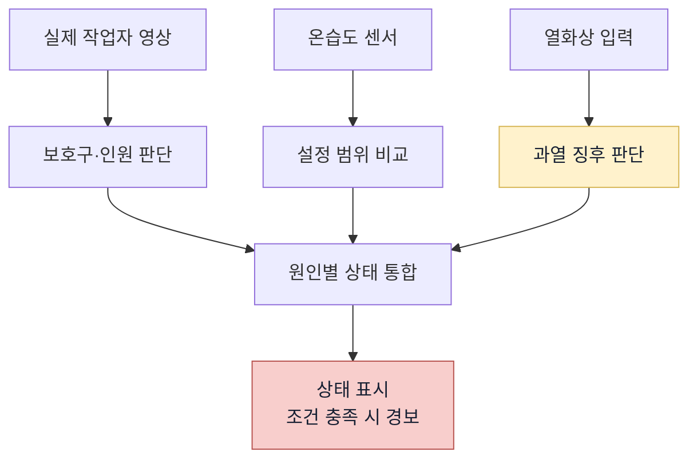

# 현장 안전 모니터링 온디바이스 AI

> **실제 사람을 감지하고, 미니 모형으로 제어 결과를 시연합니다.**  
> 설계 초안 · 2026-11-16 · 노란 도형은 판단 조건 또는 검토 항목입니다.

PC에서 보호구 모델을 학습하고, 라즈베리파이 2대에서 각각 출입구와 현장을 감시합니다. 보호구는 안전모·안전복을 뜻하며, 구체적인 안전복 판정 기준은 논의가 필요합니다.

## 1. 전체 구성



| 구분 | 감지·판단 | 제어·표시 |
|---|---|---|
| 출입구 Pi | 실제 사람의 보호구, 선택한 방식의 통과 신호 | 모형 바리케이드·출입구 LED |
| 현장 Pi | 실제 작업자의 보호구·인원, 공기 온습도, 발열 대상 | 화면·모형 LED·부저 |

**구현 목표:** 각 Pi에서 추론합니다. 실제 촬영 환경의 인식 성능·처리 속도는 장치에서 검증합니다.

## 2. 출입구 — 보호구 판정



도형의 ‘그 외 상태’는 아래 세 상태를 각각 구분해 처리한다는 뜻입니다. 확인 불가를 미착용으로 합치지 않습니다.

| 상태 | 동작 |
|---|---|
| 같은 사람의 안전모·안전복 착용 확인 | 연속 확인 조건 충족 시 개방 승인 |
| 안전모 또는 안전복 미착용 | 개방 보류·빨간 LED·미착용 원인 표시 |
| 가림·낮은 신뢰도로 확인 불가 | 개방 승인 보류·재확인 |
| 사람 없음 | 개방 없이 대기 |

**반복:** ‘다음 영상 재확인’은 위의 ‘실제 사람 영상’ 단계로 돌아갑니다. 촬영 시작 조건, 연속 확인 시간, 여러 사람 동시 접근 정책은 미정입니다. 서로 다른 사람의 보호구를 합쳐 승인하지 않습니다.

## 3. 출입구 — 통과 확인



**통과 방식은 회의에서 A/B 중 선택합니다.** 모형 문이 열렸다는 사실만으로 실제 사람이 입장했다고 판단하지 않습니다.

| 방식 | 센서 설치·시연 방법 | 화면·집계 |
|---|---|---|
| A. 실제 사람 동선 | 실제 시연 동선에서 초음파로 통과 판정 | 사람 통과 신호. 방향 판정·집계 활용 가능 여부는 실험 필요 |
| B. 모형 동선 | 모형의 센서를 손·물체로 통과시키는 시연 | ‘모형 통과 신호’로 표시. 실제 입장·재실 인원 근거로 사용하지 않음 |

**반복·예외:** ‘통과 신호 재확인’은 ‘통과 신호 확인’으로 돌아갑니다. 대기 한도 초과 시 재확인·관리자 조작 등 미통과 정책을 적용하며, 구체적 정책은 미정입니다. 정책에 따라 재개하면 통과 신호 확인으로 돌아갑니다. 초음파 하나로 통과·방향·장애물을 모두 판정할 수 있다고 가정하지 않습니다.

## 4. 출입구 — 닫힘 제어



| 항목 | 적용 내용 |
|---|---|
| 닫힘 시작 | 선택한 방식의 통과 확인 후 설정 시간 대기 |
| 닫힘 조건 | 모형의 장애물 확인 방법과 조건을 회의에서 확정 |
| 조건 미충족·확인 불가 | 닫힘을 보류하고 조건 재확인 또는 관리자 조작 |
| 닫힘 명령 후 | 실제 완료 확인과 실패 처리 방법을 정함. 명령 전송과 완료는 구분 |
| 반복 | 완료 확인 후 보호구 판정 단계에서 다음 사람을 확인 |

## 5. 현장 — 지속 모니터링



각 입력은 독립적으로 감시하고 최신 상태를 함께 표시합니다. 한 입력의 지연 때문에 다른 감시가 멈추지 않도록 설계합니다. 표시 후 상태 변화·발생/복귀 시각을 기록하고 다음 감시 주기를 계속합니다.

| 입력 | 판단 내용 | 구분할 사항 |
|---|---|---|
| 실제 작업자 RGB 영상 | 사람별 보호구 상태, 합의한 정의의 인원 수 | 착용·미착용·확인 불가·사람 없음·영상 오류 |
| 온습도 센서 | 주변 공기의 온도·습도 범위 이탈 | 온도·습도 원인, 입력 만료·오류 |
| 열화상 | 지정 구역의 물체 표면 온도·상승 추세·과열 영역 | 고온 감지만으로 화재를 확정하지 않음 |

**경보 표시:** 미착용·환경 이상·과열 등 모든 활성 원인을 유지합니다. ‘경보 없음’이어도 확인 불가·장치 오류는 별도로 표시합니다. 부저 음소거와 경보 원인 해제는 구분합니다.

**인원 표시:** 화면에 보이는 검출 수와 출입을 추적한 재실 인원 중 무엇을 의미하는지 정해야 합니다. 가림·화면 밖 대상 처리도 논의합니다. 모형 통과 신호는 실제 사람 집계에서 제외합니다.

## 6. 공통 예외와 미정 항목

| 항목 | 현재 방향·회의에서 결정할 내용 |
|---|---|
| 초기화·장치 오류 | 시작·재시작 시 장치와 모터 초기 상태 확인. 오류는 정상과 별도로 표시하고 자동 개방을 보류. 복구 후 초기 점검 |
| 감시 지속 | 한 장치가 고장 났을 때 나머지 감시를 지속할지와 오류 중 제어 정책 합의 |
| 보호구 판정 | 안전복 정의·신뢰도·연속 확인·미착용 지속·정상 복귀 기준 |
| 모형 제어 | 모터 종류·개폐 완료 확인·미통과·장애물·닫힘 실패 정책 |
| 센서 후보 | 열화상 MLX90640 / 온습도 SHT40 또는 기존 DHT11. 구매·화각·설치 위치는 미정 |
| 센서 배치 | 실제 공간과 모형 중 측정 위치를 정하고 화면·로그에 명시 |
| 화재 징후 판단 | 열화상 온도 규칙·영상 AI·결합 방식 논의. RGB 학습 모델을 열화상에 바로 적용하지 않음 |
| 경보 | 주의·경고 단계, 원인별 우선순위, 지속·복귀·오경보 기준 |
| 선택 연동 | Pi 간 통신·통합 화면·LCD·출입구 부저·화재 의심과 모형 바리케이드 연동 |
| 시연 입력 | 실제 측정·따뜻한 시험 물체·녹화·모의 입력을 구분해 기록 |

## 7. 수정 방법

**이 README의 Mermaid 코드가 GitHub 표시 기준입니다.** GitHub의 Edit(연필)에서 따옴표 안의 글자와 화살표를 수정합니다.

```text
A["단계 이름"] --> B{"조건?"}
B -->|"예"| C["다음 단계"]
```

- 도형에는 짧은 단계명만 넣습니다. 긴 설명은 표·본문에 적습니다.
- 한 그림은 한 가지 흐름만 담습니다. 여러 단계로 돌아가는 긴 복귀선 대신 본문에 반복 위치를 설명합니다.
- 각 Mermaid 코드 블록은 별개이므로 도형 ID를 다른 그림과 연결하지 않습니다.
- `flowcharts/*.mmd`는 그림별 편집용 사본입니다. `.mmd`를 고치면 해당 내용을 README 코드 블록에도 반영합니다. 자동 동기화되지 않습니다.
- [draw.io 원본](flowcharts/project-flowchart.drawio)은 이전 3페이지 상세 도식입니다. 이번 5개 요약 그림과 자동 동기화되지 않으며, 시각적 배치도 다릅니다.

## 변경 이력

| 버전 | 날짜 | 내용 |
|---|---|---|
| v0.3 | 2026-11-16 | 긴 설명 도형 제거, 출입 흐름 3개로 분리, 예외·미정 항목 표로 이동 |
| v0.2 | 2026-11-16 | 실제 사람 인식·미니 모형 제어로 변경 |
