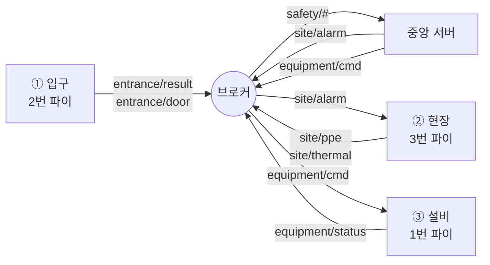

# 통신 (MQTT)
 
노트북 1대와 라즈베리파이 3대가 **MQTT**로 메시지를 주고받는 기본 통신 코드입니다.
지금은 센서·AI 대신 **키보드 입력으로 상황을 흉내 내서** 통신만 확인하는 단계예요.
 
## 구성
 
| 기기 | 역할 | 호스트명 | IP (예시) | 언어 | 파일 |
|---|---|---|---|---|---|
| 노트북 | 브로커 + 중앙 서버 | - | 192.168.20.123 | Python | `server/server.py` |
| **1번 파이** | ③ 설비 제어부 | JGH1628 | 192.168.20.26 | C | `equipment/pi_equipment.c` |
| **2번 파이** | ① 입구 제어부 | rpi-jsm6049 | 192.168.20.45 | Python | `entrance/pi_entrance.py` |
| **3번 파이** | ② 현장 감시부 | rpi-kks2021 | 192.168.20.168 | Python | `site/pi_site.py` |
 
> IP는 공유기가 자동으로 나눠주기 때문에 바뀔 수 있습니다. 접속이 안 되면 `ipconfig`(노트북)와 `hostname -I`(파이)로 먼저 확인하세요.
 
AI·카메라가 들어가는 파이는 Python, 단순 제어만 하는 설비 파이는 C로 작성했습니다.
 
## 토픽
 
모든 토픽은 `safety/파트/내용` 규칙을 따릅니다.
 
| 토픽 | 보내는 쪽 → 받는 쪽 | 내용 예시 | 의미 |
|---|---|---|---|
| `safety/entrance/result` | 입구 → 서버 | `{"helmet": true, "vest": true}` | 보호구 판정 결과 |
| `safety/entrance/door` | 입구 → 서버 | `{"door": "open"}` | 문 상태 (`open` / `closed`) |
| `safety/site/ppe` | 현장 → 서버 | `{"helmet": false, "vest": true}` | 작업자 착용 감시 결과 |
| `safety/site/thermal` | 현장 → 서버 | `{"max_temp": 65.0}` | 열화상 최고 온도 (°C) |
| `safety/site/alarm` | 서버 → 현장 | `{"alarm": "on"}` | 현장 경보 켜기/끄기 |
| `safety/equipment/cmd` | 서버 → 설비 | `{"cmd": "STOP"}` | 설비 차단(`STOP`) / 해제(`RUN`) |
| `safety/equipment/status` | 설비 → 서버 | `{"motor": "stopped"}` | 설비 상태 (`stopped` / `running`) |
 

 
| 기기 | 구독하는 토픽 |
|---|---|
| 중앙 서버 | `safety/#` (전체) |
| 현장 파이 | `safety/site/alarm` |
| 설비 파이 | `safety/equipment/cmd` |
| 입구 파이 | 없음 (보내기만 함) |
 
현재 설정: 모든 메시지 **QoS 0**, **retain 없음**, keepalive **60초**, clean session.
 
## 설치
 
### 노트북 (Windows)
 
1. [mosquitto.org/download](https://mosquitto.org/download/)에서 Windows 64비트 설치 파일을 받아 설치합니다. 설치 중 **Service 체크는 해제**하세요.
2. 관리자 권한 메모장으로 `C:\Program Files\mosquitto\mosquitto.conf`를 열고, 이 폴더의 [`mosquitto.conf`](mosquitto.conf) 내용(두 줄)을 맨 아래에 추가합니다.
3. 관리자 PowerShell에서 방화벽 1883 포트를 엽니다.
```
New-NetFirewallRule -DisplayName "MQTT 1883" -Direction Inbound -Protocol TCP -LocalPort 1883 -Action Allow
```
4. 파이썬 라이브러리를 설치합니다.
```
pip install -r requirements.txt
```
 
### 2번 파이(입구) / 3번 파이(현장) — Python
 
라즈베리파이 OS는 시스템 보호를 위해 `pip install`을 막아두므로 가상환경을 사용합니다.
`--system-site-packages`는 나중에 카메라 라이브러리(picamera2)를 같이 쓰기 위한 옵션입니다.
 
```
sudo apt update
sudo apt install mosquitto-clients
python3 -m venv --system-site-packages ~/venv
source ~/venv/bin/activate
pip install paho-mqtt
```
 
### 1번 파이(설비) — C
 
```
sudo apt update
sudo apt install build-essential libmosquitto-dev mosquitto-clients
gcc pi_equipment.c -o pi_equipment -lmosquitto
```
 
C 코드의 `#define BROKER` 주소를 바꾸면 **반드시 다시 컴파일**해야 합니다.
 
## 실행 순서
 
받는 쪽부터 켜야 메시지를 놓치지 않습니다.
 
| 순서 | 위치 | 명령 |
|---|---|---|
| 1 | 노트북 (브로커) | `cd "C:\Program Files\mosquitto"` → `.\mosquitto -c mosquitto.conf -v` |
| 2 | 노트북 (서버) | `python server.py` |
| 3 | 1번 파이 (설비) | `./pi_equipment` |
| 4 | 3번 파이 (현장) | `source ~/venv/bin/activate` → `python pi_site.py` |
| 5 | 2번 파이 (입구) | `source ~/venv/bin/activate` → `python pi_entrance.py` |
 
PowerShell에서는 현재 폴더의 프로그램 앞에 `.\`를 붙여야 실행됩니다.
 
## 통신 테스트
 
| 테스트 | 어디서 | 입력 | 확인할 곳 |
|---|---|---|---|
| 입구 → 서버 | 입구 파이 | `1`~`4` | 서버: `[수신] safety/entrance/...` |
| 현장 → 서버 | 현장 파이 | `1`~`4` | 서버: `[수신] safety/site/...` |
| 서버 → 현장 | 서버 | `3`, `4` | 현장 파이: `[수신] safety/site/alarm` |
| 서버 → 설비 → 서버 | 서버 | `1`, `2` | 설비 파이 `[수신]`·`[송신]` → 서버 `[수신] safety/equipment/status` |
 
브로커 창(`-v`)에 `as server`, `as pi_entrance`, `as pi_site`, `as pi_equipment` 4개의 접속 기록이 있어야 합니다.
 
브로커 없이 접속만 확인하고 싶을 때는 테스트 도구를 씁니다.
 
```
mosquitto_sub -h 192.168.20.123 -t "safety/#" -v -d
```
 
`received CONNACK (0)`이 나오면 접속 성공입니다.
 
## 문제 해결
 
| 증상 | 원인 | 해결 |
|---|---|---|
| PowerShell에서 `mosquitto`를 찾을 수 없음 | 현재 폴더 프로그램 실행 제한 | 앞에 `.\` 붙이기 |
| `연결을 거부했으므로 연결하지 못했습니다` | 브로커가 꺼져 있음 | 브로커 창 확인 후 다시 실행 |
| 파이 ping 결과 `Destination Host Unreachable` | 노트북 IP가 바뀜 | `ipconfig`로 확인 후 코드 주소 수정 |
| 파이 ping에 아무 응답 없음 | Windows는 ping에 응답하지 않음 (정상) | ping 대신 `mosquitto_sub`으로 확인 |
| 파이 `mosquitto_sub`이 멈춰 있고 브로커에 접속 기록 없음 | 방화벽이 1883 차단 | Windows 방화벽 규칙 추가, **백신(Avast 등) 방화벽** 확인 |
| `externally-managed-environment` | 파이 OS가 pip 설치를 막음 | 가상환경(venv) 사용 |
| `IndentationError` | nano 붙여넣기 중 들여쓰기 깨짐 | 함수 안 4칸, if 안 8칸으로 맞추기 |
 
> **참고:** Windows 보안 → 방화벽 화면에 "다른 공급자를 사용하고 있기 때문에 Microsoft Defender 방화벽이 활성화되어 있지 않습니다"가 보이면, 백신 프로그램이 방화벽을 관리하는 상태입니다. 이 경우 Windows 방화벽 규칙은 적용되지 않으니 백신 설정에서 1883 포트를 허용해야 합니다.
 