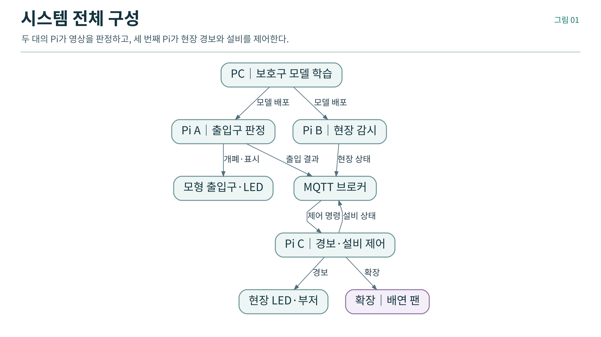
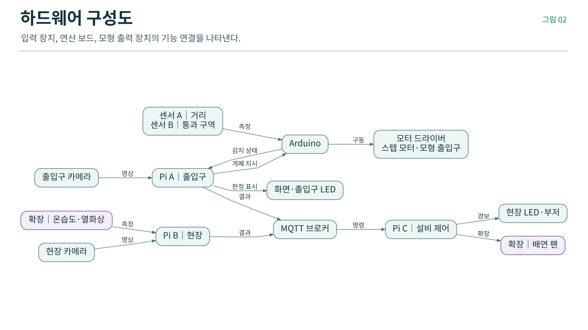
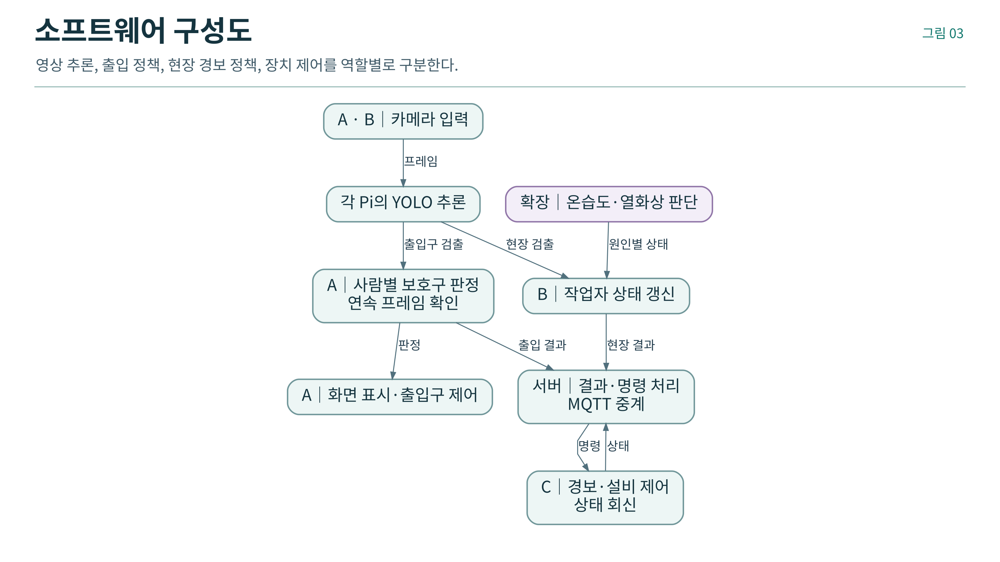
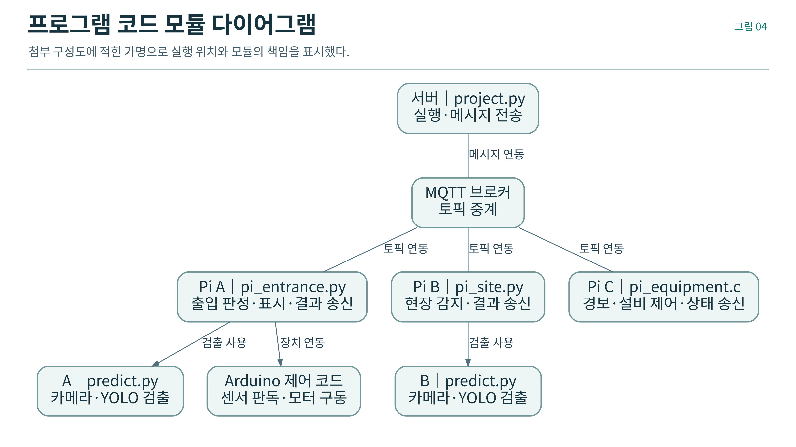
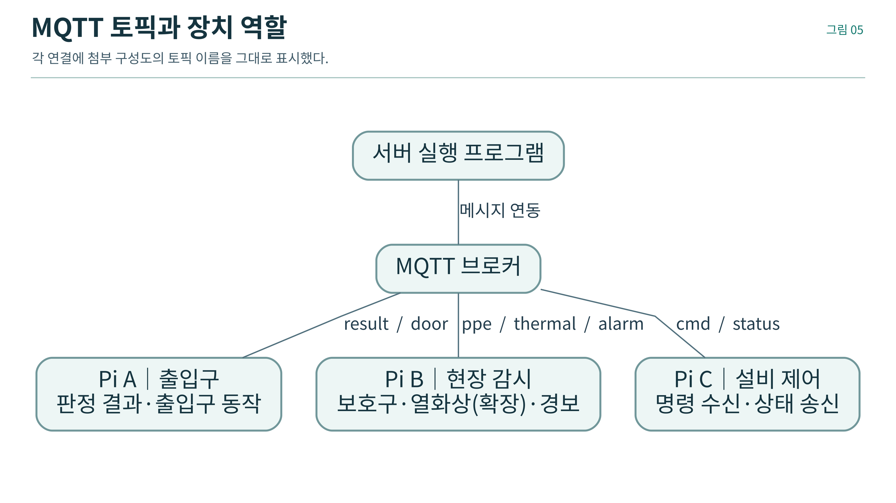
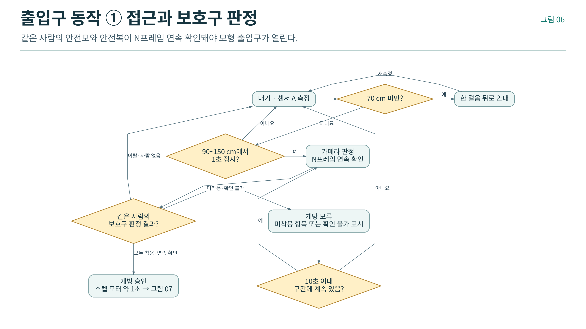
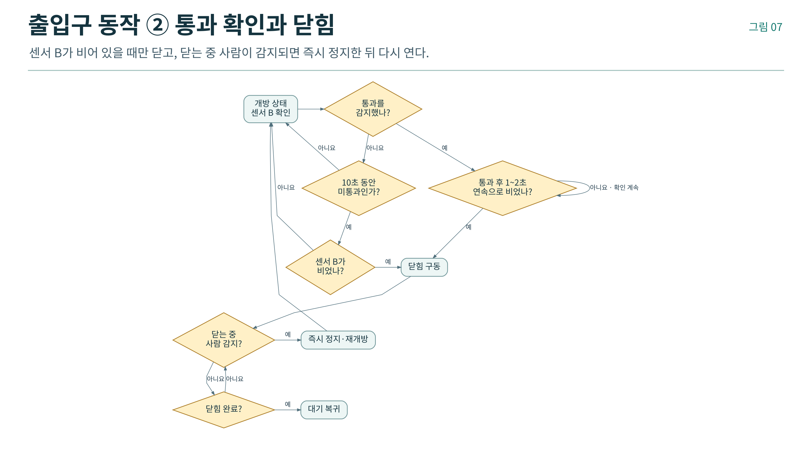
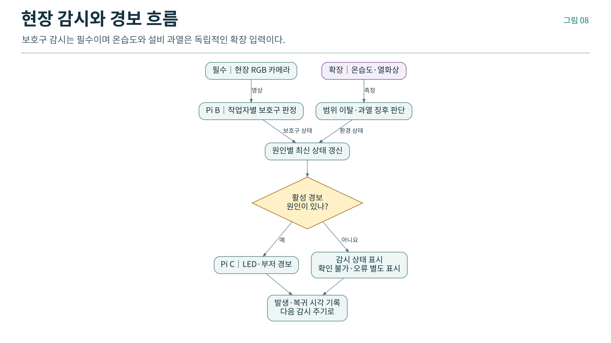
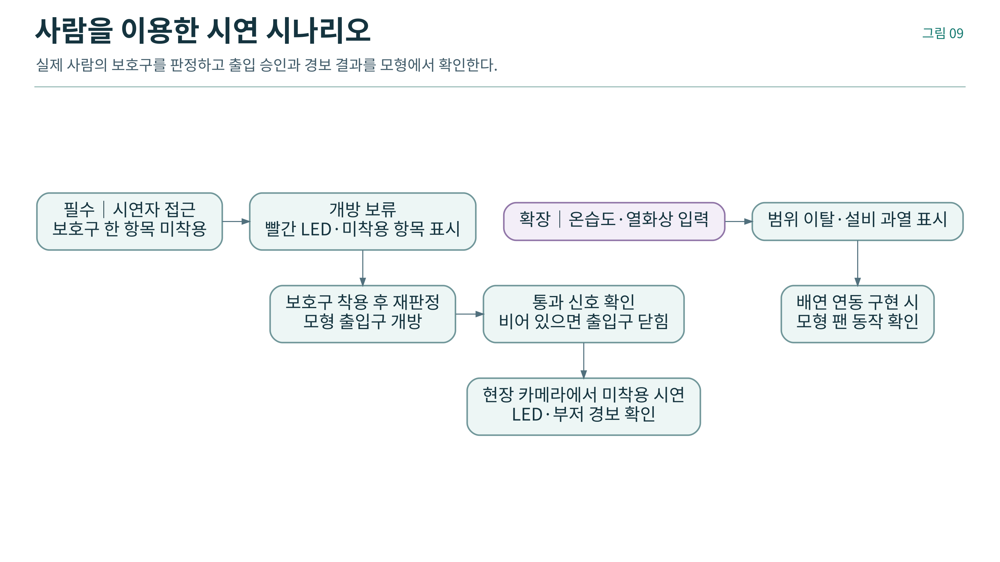
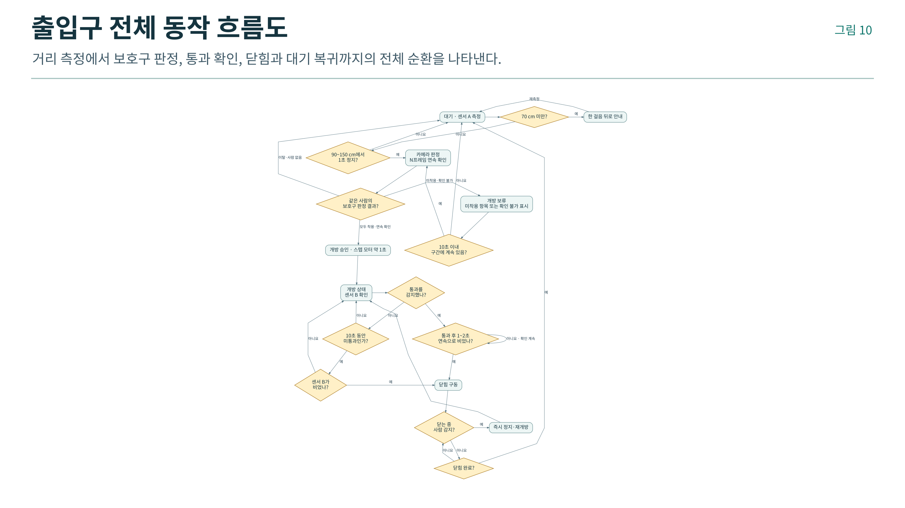

# 현장 안전 모니터링 시스템 설계 보고서

실제 작업자의 안전모와 안전복 착용 여부를 출입구와 현장에서 각각 판정하고, 결과를 모형 출입구와 경보 장치로 시연하는 시스템이다. 아래 그림은 Raspberry Pi 3대와 MQTT 서버를 사용하는 설계를 설명한다. 성능 수치와 시연 결과는 실측 후 기록한다.

| 구분 | 필수 기능 | 확장 기능 |
|---|---|---|
| 인식 | 출입구·현장 카메라의 사람별 보호구 판정 | 화재(fire, smoke) 객체, 열화상 기반 설비 이상 감지 |
| 제어 | 모형 출입구 개폐, 초음파 센서, 스크린, LED, 부저 | 배연 팬, 추가 센서를 조합한 멀티센서 연동 |
| 시연 | 실제 사람의 보호구 착탈, 개방 보류·승인, 현장 경보 | 환경 이상 입력과 설비 반응 |

## 1. 시스템 전체 구성

PC에서 보호구 모델을 학습해 출입구 Pi A와 현장 Pi B에 배포한다. 시연자가 실제로 보호구를 착용하고 카메라 앞에 서면 두 Pi가 각각 현장에서 추론한다. Pi A는 모형 출입구를 제어하고, Pi C는 현장 LED와 부저를 구동한다. MQTT 브로커는 장치 사이의 판정 결과·명령·상태 메시지를 중계한다.

*그림 1. 두 대의 Pi가 영상을 판정하고, 세 번째 Pi가 현장 경보와 설비를 제어한다.*  
[Mermaid 원본](mmd/01-system.mmd) · [벡터 그림](svg/01-system.svg)

## 2. 하드웨어 구성도

출입구 카메라와 디스플레이는 Pi A가 담당한다. Arduino는 센서 A의 거리와 센서 B의 통과 구역 상태를 읽고 모터를 제어한다. A·B는 출입구 동작도상의 센서 역할이다. 그 밖의 초음파 등 추가 센서를 조합하는 멀티센서 기능은 확장 검토 항목이다. 현장 카메라는 Pi B에 연결하고, 열화상·온습도 입력과 배연 팬은 확장 시 추가한다. 이 그림은 기능 연결도이며 핀 배치와 통신 인터페이스는 별도 설계 대상이다.

*그림 2. 입력 장치, 연산 보드, 모형 출력 장치의 기능 연결을 나타낸다.*  
[Mermaid 원본](mmd/02-hardware.mmd) · [벡터 그림](svg/02-hardware.svg)

## 3. 소프트웨어 구성도

Pi A와 Pi B의 카메라 처리부는 프레임에서 사람과 보호구를 검출한다. Pi A는 같은 사람의 안전모와 안전복을 연결해 연속 확인 조건을 적용한다. Pi B는 감시 원인을 독립적으로 갱신한다. 서버 측 실행 프로그램이 메시지를 처리하고, 브로커가 해당 토픽의 구독자에게 전달한다.

*그림 3. 영상 추론, 출입 정책, 현장 경보 정책, 장치 제어를 역할별로 구분한다.*  
[Mermaid 원본](mmd/03-software.mmd) · [벡터 그림](svg/03-software.svg)

## 4. 프로그램 코드 모듈 다이어그램

project.py는 전체 실행과 메시지 전송을 맡는 서버 측 프로그램의 가명이다. pi_entrance.py와 pi_site.py는 각 Pi에서 predict.py의 카메라·YOLO 추론 기능을 사용한다. Arduino의 센서·모터 제어 코드는 Pi A와 연동한다. pi_equipment.c는 Pi C에서 경보와 설비를 제어하고 상태를 전송한다. 선은 모듈 간 역할 관계로, 함수 호출이나 실제 저장소 경로를 지정하지 않는다.

*그림 4. 첨부 구성도에 적힌 가명으로 실행 위치와 모듈의 책임을 표시했다.*  
[Mermaid 원본](mmd/04-modules.mmd) · [벡터 그림](svg/04-modules.svg)

## 5. MQTT 토픽과 장치 역할

result와 door는 출입구, ppe·thermal·alarm은 현장 감시, cmd와 status는 설비 제어에 대응한다. 원도에는 토픽별 발행자·구독자 표가 없어 선은 장치와 브로커 사이의 토픽 묶음을 나타낸다. QoS와 메시지 형식도 확정 사양으로 두지 않았다.

*그림 5. 각 연결에 첨부 구성도의 토픽 이름을 그대로 표시했다.*  
[Mermaid 원본](mmd/05-mqtt.mmd) · [벡터 그림](svg/05-mqtt.svg)

## 6. 출입구 동작 ① 접근과 보호구 판정

센서 A에서 70 cm보다 가까우면 “한 걸음 뒤로”를 안내한다. 90~150 cm 구간에 1초 정지하면 판정한다. 판정 중 구간을 벗어나거나 사람이 없으면 즉시 대기한다. 미착용은 빨간 LED와 미착용 항목으로 안내하고, 가림이나 낮은 신뢰도는 확인 불가로 표시한다. 보류 시 10초 이내 구간에 계속 있으면 재판정한다. 연속 확인 프레임 수 N과 안전복 세부 기준은 미정이다.

*그림 6. 같은 사람의 안전모와 안전복이 N프레임 연속 확인돼야 모형 출입구가 열린다.*  
[Mermaid 원본](mmd/06-entry.mmd) · [벡터 그림](svg/06-entry.svg)

## 7. 출입구 동작 ② 통과 확인과 닫힘

사람이 지나간 뒤 센서 B가 1~2초 비면 닫힘을 시작한다. 개방 상태에서 10초 동안 아무도 지나가지 않은 경우에도 센서 B가 비어야 닫을 수 있다. 모터에 닫힘 명령을 보낸 것과 실제 닫힘 완료는 구분하며, 완료 확인 방법은 미정이다. 모형 동선에서 손이나 물체로 발생시킨 신호를 실제 입장 인원으로 집계하지 않는다.

*그림 7. 센서 B가 비어 있을 때만 닫고, 닫는 중 사람이 감지되면 즉시 정지한 뒤 다시 연다.*  
[Mermaid 원본](mmd/07-passage.mmd) · [벡터 그림](svg/07-passage.svg)

## 8. 현장 감시와 경보 흐름

Pi B는 사람별 보호구 상태를 갱신하고 미착용과 확인 불가, 사람 없음, 영상 오류를 구분한다. 환경 입력에서는 공기 온습도와 물체 표면 온도를 구분한다. 경보 조건을 충족한 원인은 동시에 유지하고 발생·복귀 시각을 기록한다. 부저를 음소거해도 원인 상태는 유지한다. 고온은 과열 징후이며 화재 확정 기준과 배연 연동 조건은 별도 검토한다.

*그림 8. 보호구 감시는 필수이며 온습도와 설비 과열은 독립적인 확장 입력이다.*  
[Mermaid 원본](mmd/08-monitor.mmd) · [벡터 그림](svg/08-monitor.svg)

## 9. 사람을 이용한 시연 시나리오

필수 시연에서는 같은 사람이 보호구 하나를 벗은 상태로 접근한 뒤 안내를 보고 다시 착용한다. 이어 통과 신호, 모형 출입구의 닫힘, 현장 카메라의 미착용 경보를 차례로 확인한다. 확장 시연은 온도 또는 열화상 입력부터 별도로 시작한다. 실제 측정·시험 물체·모의 입력 중 어떤 방식을 사용했는지 표시하고, 팬 연동은 확장 구현 시에만 시연한다.

*그림 9. 실제 사람의 보호구를 판정하고 출입 승인과 경보 결과를 모형에서 확인한다.*  
[Mermaid 원본](mmd/09-demo.mmd) · [벡터 그림](svg/09-demo.svg)

## 10. 출입구 전체 동작 흐름도

그림 6과 7의 연결 관계를 한 장으로 묶었다. 보류 뒤 재판정과 닫힘 중 재개방은 각각 카메라 판정 단계와 통과 감시 단계로 복귀한다.

*그림 10. 거리 측정에서 보호구 판정, 통과 확인, 닫힘과 대기 복귀까지의 전체 순환을 나타낸다.*  
[Mermaid 원본](mmd/10-full-entry.mmd) · [벡터 그림](svg/10-full-entry.svg)

## 검증 항목

- 다른 사람의 안전모와 안전복이 함께 보일 때 잘못 승인하는지 확인한다.
- 미착용·가림·사람 없음·영상 오류가 각각 올바르게 표시되는지 확인한다.
- 통과 후 닫힘, 미통과 10초, 닫힘 도중 재감지에 대해 기대 동작과 관찰 결과를 비교한다.
- 현장 감시에서는 부저 음소거 후에도 활성 경보 원인이 남는지 확인한다.
- 확장 시연에서는 공기 온습도와 물체 표면 온도의 입력 출처를 기록한다.

설계 근거는 제공된 README v0.3, 출입구 동작 흐름도, MQTT 프로그램 구성도와 Pi 3대 구성 결정이다.
